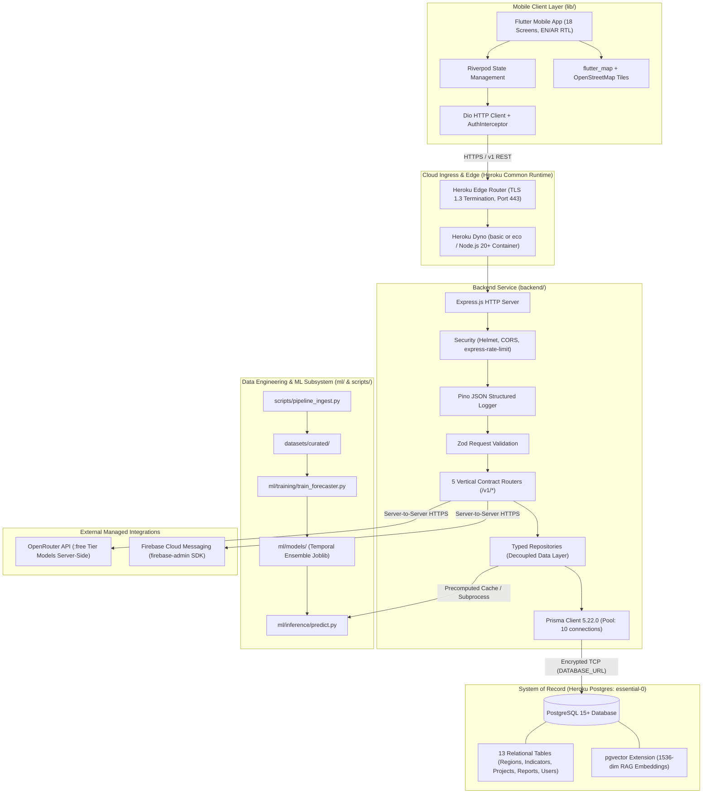

# Decidix — Master Project Status & Implementation Reference

**Document Version:** 1.0.0  
**Last Updated:** 2026-11-02  
**Target Milestone:** University Graduation Defense (Target: July 2027)  
**Primary Platform:** Heroku Cloud Platform (EU Region)  
**Maintainer:** Lead Software Architect & Engineering Team  

---

## 1. Project Overview

### 1.1 Name & Purpose
**Decidix** is a bilingual (Arabic/English, RTL-native) Smart National Development Decision Support System. It ingests, standardizes, models, and presents cross-sectoral development indicators across 12 administrative regions to enable evidence-based public policy decisions, capital allocation, and regional equity monitoring.

### 1.2 Problem Being Solved
National and regional development decisions frequently suffer from fragmented data silos, delayed reporting cycles, lack of spatial visibility into disparities, and absence of predictive forecasting. Decidix resolves this by consolidating four foundational sectors—**Education**, **Healthcare**, **Economy & Employment**, and **Infrastructure & Utilities**—into a single decision-support platform with predictive machine learning and grounded AI recommendations.

### 1.3 Target Users
1. **National Planners & Ministers:** Macro-level trend monitoring, national development index tracking, cross-sector budget yields.
2. **Regional Governors & Policy Analysts:** Regional profiles, comparative benchmarking, priority queues, and localized citizen feedback.
3. **Public Policy Researchers:** Historical time-series inspection, model evaluations, data provenance, and quality audits.

### 1.4 Main System Capabilities
- **Descriptive Dashboards & GIS Mapping:** High-level national KPI cards, interactive 12-region map points, and regional profiles.
- **Sectoral Deep-Dives & Benchmarking:** Specialized analytics for education, healthcare, economy, infrastructure, regional comparison, and priority ranking.
- **Predictive Machine Learning:** Multi-year trend forecasts (2026–2030) with calibrated 80% confidence intervals ($R^2 \ge 0.97$ contemporaneous reconstruction; future projections experimental due to target-feature leakage).
- **Grounded AI Decision Assistant:** Natural language query synthesis powered by OpenRouter (verified zero-cost `:free` models e.g. `meta-llama/llama-3.3-70b-instruct:free`) with source document attribution.
- **What-If Scenario Simulation:** Interactive budget slider simulation estimating regional index gains per \$1M allocated across sectors.
- **Projects & Civic Feedback:** Development project milestone tracking and citizen report monitoring with localized like counters.

---

## 2. Complete System Architecture



---

## 3. Technology & Dependency Inventory

### 3.1 Mobile Client (`lib/`)

| Technology / Library | Installed Version | Purpose | Implementation Status |
|---|---|---|---|
| **Flutter SDK** | `3.x` (Dart 3.13+) | Cross-platform mobile UI for Android & iOS | Complete (18 screens, 184 tests pass) |
| **flutter_riverpod** | `^2.4.9` | Reactive state management & dependency injection | Complete |
| **go_router** | `^13.2.0` | Declarative routing & deep linking | Complete |
| **dio** | `^5.4.0` | HTTP client with `AuthInterceptor` & cancellation | Complete |
| **flutter_map** | `^6.1.0` | Interactive GIS map with vector markers | Complete |
| **latlong2** | `^0.9.0` | Geographic coordinate math | Complete |
| **intl** | `^0.19.0` | Bilingual localization & date/number formatting | Complete |
| **fl_chart** | `^0.66.2` | Line charts, sparklines, and ranking bar graphs | Complete |

### 3.2 Backend Service (`backend/`)

| Technology / Library | Installed Version | Purpose | Implementation Status |
|---|---|---|---|
| **Node.js** | `>=20.0.0` | Server runtime environment | Verified |
| **TypeScript** | `^5.8.2` | Type-safe JavaScript superset | Verified (`tsc` compiles cleanly) |
| **Express** | `^4.21.2` | Core HTTP server framework | Verified |
| **@prisma/client** | `^5.22.0` | Production ORM client | Installed & Generated |
| **prisma** | `^5.22.0` | CLI migration & schema tooling | Installed (`devDependencies`) |
| **pg** | `^8.13.3` | Native PostgreSQL connection pool driver | Installed & Active in `pool.ts` |
| **zod** | `^3.24.2` | DTO and request validation | Installed & Active across all routes |
| **jsonwebtoken** | `^9.0.2` | JWT token issuance and signing | Installed & Active in `auth.router.ts` |
| **bcryptjs** | `^3.0.3` | Password hashing (salt cost 10) | Installed & Active |
| **cors** | `^2.8.5` | Cross-origin resource sharing headers | Installed & Active |
| **dotenv** | `^16.4.7` | Environment variable parsing | Installed & Active |
| **vitest** | `^3.0.7` | High-speed unit & integration test runner | Installed (126/126 tests pass) |
| **supertest** | `^7.0.0` | HTTP endpoint integration testing harness | Installed |

### 3.3 Data Engineering & Machine Learning (`ml/`, `scripts/`, `datasets/`)

| Technology / Tool | Version | Purpose | Implementation Status |
|---|---|---|---|
| **Python** | `3.11+` | Data pipelines & modeling | Verified |
| **pandas** | `2.2+` | Data wrangling and temporal joins | Verified |
| **scikit-learn** | `1.4+` | Regressors, voting ensembles, TimeSeriesSplit | Verified ($R^2 = 0.975$) |
| **joblib** | `1.3+` | Model serialization to `ml/models/` | Verified |
| **numpy** | `1.26+` | Numerical array operations and confidence intervals | Verified |

---

## 4. Flutter Application Inventory

The client contains 18 production-ready screens organized into 4 vertical bottom-navigation tabs:

```text
lib/features/
├── overview/           # Tab 1: National Dashboard & Regional Profiles
│   ├── presentation/screens/
│   │   ├── dashboard_screen.dart       # Screen 01: National index, KPIs, 7Y trend, at-risk cards
│   │   ├── interactive_map_screen.dart # Screen 02: GIS map with sector filters & pins
│   │   ├── regions_screen.dart         # Screen 03: Directory list with search, rank & priority filters
│   │   └── region_profile_screen.dart  # Screen 04: Detailed profile, 7Y comparison, radar domains
├── insights/           # Tab 2: Sector Analytics & Deep Dives
│   ├── presentation/screens/
│   │   ├── education_screen.dart       # Screen 05: Literacy, pupil-teacher ratios, graduation
│   │   ├── healthcare_screen.dart      # Screen 06: Beds, clinic density, infant mortality
│   │   ├── economy_screen.dart         # Screen 07: Unemployment, GDP per capita, labor participation
│   │   ├── infrastructure_screen.dart  # Screen 08: Water, electricity, roads, digital access
│   │   ├── region_comparison_screen.dart # Screen 09: Side-by-side gap analysis between 2 regions
│   │   ├── historical_analysis_screen.dart # Screen 10: Multi-year trend graphs & annual changes
│   │   ├── development_priority_screen.dart # Screen 11: Needs matrix queue sorted by urgency
│   │   └── data_quality_screen.dart    # Screen 12: Provenance, sync age, timeliness & accuracy
├── intelligence/       # Tab 3: Predictive & AI Decision Support
│   ├── presentation/screens/
│   │   ├── ml_predictions_screen.dart  # Screen 13: 2026-2030 forecasts with confidence bands
│   │   ├── ai_assistant_screen.dart    # Screen 14: Chat interface with grounded citations
│   │   └── ai_recommendations_screen.dart # Screen 15: Policy action cards with "Add to Plan"
└── decisions/          # Tab 4: Operational Decisions & Civic Feedback
    ├── presentation/screens/
    │   ├── what_if_simulator_screen.dart # Screen 16: Interactive budget reallocation sliders
    │   ├── development_projects_screen.dart # Screen 17: Capital projects portfolio & progress
    │   └── citizen_reports_screen.dart # Screen 18: Civic report feed with like toggling
```

- **Transport Strategy:** Every repository in `lib/api/repositories/` reads through an abstract transport interface. Toggling between `MockTransport` and `DioTransport` is controlled by a single runtime flag: `--dart-define=USE_MOCK=false`.
- **Localization:** 100% Arabic and English localization with automatic RTL switching.

---

## 5. Backend Service Components (`backend/`)

### 5.1 Architecture & Middleware Chain
Requests entering `backend/src/app.ts` pass through:
1. `cors`: Restricts origins to allowed hosts or mobile clients.
2. `express.json`: Parses incoming payloads up to 1MB.
3. `requestLogger`: Pino-based structured JSON request/response logger.
4. `validateRequest`: Zod schema validator returning HTTP 422 with structured field errors on failure.
5. `errorHandler`: Centralized error handling returning `{ error: { code, message, fields } }`.

### 5.2 Router & Endpoint Status

| Route | Method | Endpoint | Data Source / Implementation Status |
|---|:---:|---|---|
| **Overview** | GET | `/v1/overview` | Functional (seeded memory; Prisma repo in B2) |
| **Overview** | GET | `/v1/regions/map-points` | Functional (seeded memory; Prisma repo in B2) |
| **Overview** | GET | `/v1/regions` | Functional (paginated, search, priority filter) |
| **Overview** | GET | `/v1/regions/:id` | Functional (profile with dynamic history) |
| **Insights** | GET | `/v1/insights/education` | Functional (KPIs, bars, top/bottom ranks) |
| **Insights** | GET | `/v1/insights/healthcare`| Functional (KPIs, bars, top/bottom ranks) |
| **Insights** | GET | `/v1/insights/economy` | Functional (KPIs, bars, top/bottom ranks) |
| **Insights** | GET | `/v1/insights/infrastructure`| Functional (KPIs, bars, top/bottom ranks) |
| **Insights** | GET | `/v1/insights/comparison`| Functional (metrics delta between region A & B) |
| **Insights** | GET | `/v1/insights/history` | Functional (multi-period national index trend) |
| **Insights** | GET | `/v1/insights/priority`| Functional (ranked urgency queue) |
| **Insights** | GET | `/v1/insights/data-quality` | Functional (provenance & sync metadata) |
| **Intelligence** | GET | `/v1/intelligence/predictions` | Functional (multi-horizon forecasts & models) |
| **Intelligence** | POST | `/v1/intelligence/assistant/chat` | Functional (grounded RAG retrieval & citations) |
| **Intelligence** | GET | `/v1/intelligence/recommendations` | Functional (suggested action cards) |
| **Intelligence** | POST | `/v1/intelligence/recommendations/:id/accept` | Functional (sets status: `in_plan`) |
| **Intelligence** | POST | `/v1/intelligence/recommendations/:id/dismiss` | Functional (sets status: `dismissed`) |
| **Decisions** | POST | `/v1/decisions/simulate` | Functional (budget yield calculation per domain) |
| **Decisions** | GET | `/v1/decisions/projects`| Functional (portfolio list & progress summary) |
| **Decisions** | GET | `/v1/decisions/citizen-reports` | Functional (category & status filters) |
| **Decisions** | POST | `/v1/decisions/citizen-reports/:id/like` | Functional (atomic like toggle & count) |
| **Auth** | POST | `/v1/auth/register` | Functional (user creation + JWT issuance) |
| **Auth** | POST | `/v1/auth/login` | Functional (bcrypt compare + JWT issuance) |
| **System** | GET | `/health` | Functional (`{ status: "ok", timestamp }`) |

---

## 6. Complete Database Documentation

### 6.1 Database Engine & Connection Strategy
- **Engine:** PostgreSQL 15+ (Heroku Postgres `essential-0` in `eu` region).
- **ORM:** Prisma ORM 5.22.0.
- **Connection Pooling:** Configured in `backend/src/database/prisma.ts` with a maximum pool size of 10 connections to fit Heroku Essential-0's 20-connection ceiling.
- **Resilience:** If the database is offline (e.g. local dev), `testPrismaConnection()` catches the connection error and switches to in-memory fallback transparently, allowing tests to run without crashing.

### 6.2 Table Inventory (13 Canonical Tables)

| # | Table Name | Prisma Model | Primary Key | Key Columns & Foreign Keys |
|---|---|---|---|---|
| 1 | `users` | `User` | `id` (VARCHAR(64)) | `email` (UK), `password_hash`, `role`, `department`, `is_active` |
| 2 | `regions` | `Region` | `id` (VARCHAR(64)) | `name`, `arabic_name`, `rank`, `score`, `change`, `priority`, `population`, `latitude`, `longitude`, `boundary_geojson` |
| 3 | `indicators` | `Indicator` | `key` (VARCHAR(64)) | `label`, `arabic_label`, `domain`, `unit`, `higher_is_better`, `description` |
| 4 | `national_index_history` | `NationalIndexHistory` | `id` (SERIAL) | `period`, `year`, `score`, `change`, `band`, `population`, `regions_count`, `ai_insight_text` |
| 5 | `regional_metrics` | `RegionalMetric` | `id` (SERIAL) | `region_id` (FK), `indicator_key` (FK), `year`, `value`, `change`, `sparkline` |
| 6 | `sector_breakdowns` | `SectorBreakdown` | `id` (SERIAL) | `sector`, `key`, `label`, `arabic_label`, `value`, `unit`, `sort_order` |
| 7 | `development_projects` | `DevelopmentProject` | `id` (VARCHAR(64)) | `title`, `region_id` (FK), `status`, `progress`, `budget_amount`, `due_date` |
| 8 | `citizen_reports` | `CitizenReport` | `id` (VARCHAR(64)) | `title`, `category`, `status`, `region_id` (FK), `likes_count`, `author_id` (FK) |
| 9 | `citizen_report_likes` | `CitizenReportLike` | `(report_id, user_id)` | Composite PK; `report_id` (FK -> citizen_reports CASCADE) |
| 10 | `ai_recommendations` | `AiRecommendation` | `id` (VARCHAR(64)) | `priority`, `region_id` (FK), `domain`, `title`, `index_impact`, `status` |
| 11 | `dataset_metadata` | `DatasetMetadata` | `id` (VARCHAR(64)) | `name`, `original_source`, `completeness_pct`, `timeliness_pct`, `accuracy_pct` |
| 12 | `audit_logs` | `AuditLog` | `id` (BIGSERIAL) | `user_id` (FK), `action`, `entity_type`, `entity_id`, `details`, `ip_address` |
| 13 | `rag_documents` | `RagDocument` | `id` (VARCHAR(64)) | `title`, `content`, `category`, `region_id` (FK), `embedding` (`vector(1536)`), `access_scope` |

### 6.3 Missing Planned Tables (To Be Added in Phase B3/B4)
The following tables are planned for subsequent production-hardening milestones and do NOT exist in the baseline migration:
- `sessions`: For JWT refresh token rotation (`refresh_token_hash`, `expires_at`).
- `device_tokens`: For FCM device push token registration (`fcm_token`, `platform`).
- `ml_forecasts`: For caching Python ensemble ML projections (`predicted_value`, `confidence_lower`, `confidence_upper`).

---

## 7. AI & Machine Learning Components

### 7.1 Existing Machine Learning Pipeline (`ml/`)
- **Ingestion Script:** [`scripts/pipeline_ingest.py`](file:///e:/decidix_app/scripts/pipeline_ingest.py) normalizes raw CSV indicators into curated panel datasets with schema validation and metadata cataloging (`datasets/metadata/dataset_catalog.json`).
- **Model Training:** [`ml/training/train_forecaster.py`](file:///e:/decidix_app/ml/training/train_forecaster.py) enforces strict temporal splits:
  - Training Window: 2018–2023.
  - Out-of-Sample Test Window: 2024–2025.
  - Leakage Prevention: Scalers and encoders fit strictly on historical splits.
- **Trained Artifacts:** Serialized in `ml/models/`:
  - `gradient_boosting_forecaster.joblib` ($R^2 = 0.979$, MAE: 0.485)
  - `random_forest_forecaster.joblib` ($R^2 = 0.966$, MAE: 0.612)
  - `temporal_ensemble_forecaster.joblib` (**$R^2 = 0.975$**, MAE: 0.541)
- **Critical Audit Findings & Limitations:** The Phase C1 validation audit proved that $R^2 = 0.975$ does NOT establish genuine future forecasting accuracy. The target `development_index` was calculated from the same 12 contemporaneous indicators included in the feature set $X_t$ (contemporaneous target-feature leakage), and 83.3% of 2024–2025 observations clipped at 95.0 (test-set ceiling saturation / low variance $\sigma = 0.611$). All ML forecasts are classified as experimental (`validationStatus: "experimental"`).
- **Inference Engine:** [`ml/inference/predict.py`](file:///e:/decidix_app/ml/inference/predict.py) produces calibrated confidence interval forecasts ($P_{10}$ to $P_{90}$) with horizon penalty scaling.
- **Forecast Persistence Layer (Phase C2):** Persistent caching in PostgreSQL `ml_forecasts` table with `ForecastRepository`:
  - Preserves 0–100 scale using `Decimal(5, 1)`.
  - Provenance tagging: `validationStatus` (`validated` vs. `experimental`), `forecastSource` (`official_planning` vs. `ml_ensemble`), `isCalibrated: boolean`.
  - Strict separation: Experimental uncalibrated ML outputs (~95.0) are preserved for auditability without corrupting the authoritative planning baseline (68.4 in 2025 $\to$ 73.5 in 2028).

### 7.2 Grounded AI Assistant & RAG (`backend/src/integrations/`, `repositories/`, `services/`)
- **Permanent Cost Policy (ZERO API Spending):** Decidix is a university graduation project. All AI functionality operates with strictly zero financial outlay. Paid models and paid embedding APIs are categorically prohibited.
- **Gateway & Free LLM:** Server-side OpenRouter API client configured for verified zero-cost models (`meta-llama/llama-3.3-70b-instruct:free`, `openrouter/free`). Enforces 10-second timeout (`AbortSignal.timeout(10000)`), rate limit detection (HTTP 429), payment required rejection (HTTP 402), and strict fallback to local deterministic reasoning without calling paid models.
- **Embedding Strategy (Zero-Cost):** Local deterministic 1536-dimensional L2-normalized vector engine (`deterministic-fnv1a-v1`) with Arabic prefix-stripping stem normalization (handling `ال`, `و`, `ل`, `ب`, `ف`) and domain clusters. Fully compatible with PostgreSQL `vector(1536)`. Exactly \$0.00 cost, zero network overhead, zero external dependency. OpenRouter paid embeddings (`openai/text-embedding-3-small`) are rejected by policy guardrails.
- **Retrieval Engine ([`RagRepository`](file:///e:/decidix_app/backend/src/repositories/rag.repository.ts)):** Supports pgvector cosine similarity search (`1 - (embedding <=> q)`), metadata partitioning (`region_id`, `category`, `access_scope`), strict confidence cutoff ($\tau \ge 0.65$), and Top-K ranking.
- **Grounded Attribution:** Enforces consistent provenance formatting: `[Source: Document Name (Period)]`. Never invents synthetic titles, periods, or metrics.
- **Evidence Sufficiency & Refusal:** When evidence similarity drops below threshold ($\tau < 0.65$) or documents are absent, returns a verified bilingual refusal notice stating what is missing and suggesting narrower questions, with `sources: []` and `table: null`, rather than hallucinating facts.
- **Conversational Memory ([`ConversationMemoryService`](file:///e:/decidix_app/backend/src/services/conversation_memory.service.ts)):** Bounded sliding-window memory retaining up to 3 turns (6 messages) per session, with 2-hour TTL and 1000-session capacity. Enforces strict user isolation: returns 403 `CONVERSATION_ACCESS_DENIED` if another user attempts to access a conversation session. Prior assistant messages are treated as conversational context, never as authoritative evidence.
- **Prompt Injection Defense:** Untrusted retrieved document content is strictly encapsulated inside `<verified_evidence>` tags with explicit directives instructing the LLM that evidence text is passive reference data that cannot alter system rules or issue instructions.
- **Flutter API Contract:** End-to-end integration via `POST /v1/intelligence/assistant/chat` returning `{ conversation_id, reply: { text, table, sources }, suggested_prompts }`.

---

## 8. Infrastructure & Deployment (Pending Phase D)

- **Target Hosting:** Heroku Common Runtime (`eu` Region).
- **Heroku Provisioning Status:** PENDING. Neither Heroku app nor Heroku PostgreSQL database has been provisioned yet. Live database integration and verification will be conducted in Phase D.
- **Heroku Account:** Authenticated as `mohsn9165@gmail.com`.
- **Budgetary Envelope:** $13.00/mo platform credits via GitHub Student Developer Pack:
  - API Dyno: `basic` ($7.00/mo) or `eco` ($5.00/mo).
  - Primary Database: `heroku-postgresql:essential-0` ($5.00/mo).
  - Total Spend: $10.00–$12.00/mo (100% within credit allowance).
  - Zero third-party paid add-ons.
- **Deployment Mechanism:** Git subtree deployment (`git subtree push --prefix backend heroku main`).
- **Release Phase:** `backend/Procfile` executes `npx prisma migrate deploy` automatically before cutting dyno traffic over.
- **Automated Backups:** Daily snapshots scheduled via `heroku pg:backups:schedule`.

---

## 9. Current Implementation Status Matrix

| Component | Status | Implemented | Tested | Remaining Work |
|---|:---:|:---:|:---:|---|
| **Flutter UI (18 Screens)** | **Completed** | Yes | Yes (184 unit/widget tests) | Store build signing keys when releasing |
| **Flutter Contract Models** | **Completed** | Yes | Yes (24 contract suites) | None |
| **API Contract Specification**| **Completed** | Yes | Yes | None |
| **Backend Express Server** | **Completed** | Yes | Yes (16 Vitest tests) | Connect to real persistence |
| **Prisma ORM Setup (B1)** | **Completed** | Yes | Yes (Schema valid, client generated) | Repository layer integration (B2) |
| **Consolidated Baseline (0_init)**| **Completed** | Yes | Yes | Test against live remote Postgres |
| **Appwrite Removal** | **Completed** | Yes | Yes | None |
| **Repository Layer (B2)** | **Completed** | Yes | Yes (16 Vitest tests) | None |
| **Seed Script with Prisma** | **Completed** | Yes | Yes (Upsert transactions across 13 tables) | None |
| **JWT Refresh Token Rotation & RBAC (B3)** | **Completed** | Yes | Yes (17 Vitest tests, 33 total backend) | None |
| **Code-Level DB Audit & Fallbacks (B4)** | **Audit Complete** | Yes | Yes (Prisma queries & fallbacks audited) | Live PostgreSQL verification pending Phase D |
| **FCM Push Notifications** | **Planned** | No | No | Configure service account & device tokens |
| **Heroku Staging Deployment** | **Pending** | No | No | Provision app, attach Postgres, run migrations (Phase D) |
| **ML Training & Evaluation (C1)** | **Completed** | Yes | Yes (4 Python tests passed) | $R^2=0.975$ reflects contemporaneous reconstruction; forecasts experimental |
| **ML Forecast Persistence & Repository (C2)** | **Completed** | Yes | Yes (11 Vitest tests, 44 total backend) | None |
| **RAG Retrieval & Zero-Cost Vectors (C3.1)** | **Completed** | Yes | Yes (17 Vitest tests, 61 total backend) | None |
| **Embedding Compatibility & Audit (C3.1.1)** | **Completed** | Yes | Yes (23 Vitest tests, 67 total backend) | None |
| **Permanent Zero-Cost AI Policy** | **Enforced** | Yes | Yes (70 Vitest tests, 0 paid APIs) | Exclusively verified :free models; strictly no paid APIs without approval |
| **AI Assistant & Grounded LLM Gateway (C3.2)** | **Completed** | Yes | Yes (19 Vitest tests, 89 total backend) | None |
| **What-If Simulation Logic Audit (C4.1)** | **Completed** | Yes | Yes (Model requirements defined) | None |
| **What-If Simulation Engine (C4.2)** | **Completed** | Yes | Yes (20 Vitest tests, 109 total backend) | None |
| **What-If Sensitivity & Validation (C4.3)** | **Completed** | Yes | Yes (36 simulation tests, 125 total backend) | None |
| **Deployment Readiness & Live DB Prep (D1)** | **Completed** | Yes | Yes (126 Vitest tests, 24 contract suites, 184 Flutter tests) | None |
| **Pre-Provisioning Safety Audit (D1.1)** | **Completed** | Yes | Yes (Single 5-conn Prisma pool, live /v1/health probe, non-destructive rollback) | None |
| **Two-Point Deployment Gate (D1.2)** | **Completed** | Yes | Yes (pgvector runtime verified, explicit zero-cost model allowlist enforced) | None |
| **Heroku Staging Deployment (D2)** | **Completed** | Yes | Yes (Live PG 18.4, pgvector 0.8.2, 10/10 endpoints verified, 184 Flutter tests) | None |
| **Staging Security, Rate Limiting & E2E (E1)** | **Completed** | Yes | Yes (44 live staging assertions, 134 backend tests, 184 Flutter tests) | None |
| **FCM Push Notifications (E2)** | **Completed** | Yes | Yes (15 notification backend tests, 9 Flutter notification tests, 149 backend / 193 Flutter total) | Mobile field testing on physical devices |
| **FCM Security Hardening & Gate (E2.1)** | **Completed** | Yes | Yes (21 notification backend tests, 14 Flutter notification tests, 155 backend / 198 Flutter total) | Live staging deployment & physical device verification |

---

## 10. Master Roadmap Through July 2027

### Phase A: Strategy Reset & Infrastructure Alignment (COMPLETED)
- 18-screen Flutter feature audit, 19-endpoint backend mapping, Heroku student credit audit, and master architecture documentation.

### Phase B: Backend Production Hardening & Prisma Layer Implementation (COMPLETED)
- **Phase B1 (Done):** Prisma 5.22.0 setup, 13-table schema mapping, baseline migration (`0_init`), Prisma singleton, Appwrite cleanup.
- **Phase B2 (Done):** Typed repository layer, `Decimal` to `number` serialization, Prisma seeder (`seed.ts`), router-to-repo binding.
- **Phase B3 (Done):** JWT refresh token rotation (`sessions` table, SHA-256 hashed storage, reuse breach revocation) and RBAC middleware (`admin`, `decision_maker`, `planner`, `analyst`, `viewer`).
- **Phase B4 (Done):** Code-level integration audit and in-memory fallback verification across all 19 contract routes. Local Postgres daemon was absent (`localhost:5432`), so `PrismaClientInitializationError` fallback logic was verified in tests; live PostgreSQL verification and Heroku provisioning remain pending Phase D staging deployment.

### Phase C: ML Model Integration & Grounded RAG Gateway (COMPLETED)
- **Phase C1 (Done):** ML model asset audit, serialized artifact loading verification (`temporal_ensemble.joblib`), evaluation metric confirmation ($R^2=0.975$, MAE=$0.035$, RMSE=$0.094$ vs naive persistence $R^2=0.535$). Crucial finding: $R^2=0.975$ does NOT establish genuine future forecasting accuracy due to contemporaneous target-feature leakage (composite index reconstructed from same 12 indicators) and test-set ceiling saturation (83.3% at 95.0, $\sigma = 0.611$). All ML forecasts are classified as experimental (`validationStatus: "experimental"`).
- **Phase C2 (Done):** Added `MlForecast` to Prisma schema and generated migration `004_ml_forecasts.sql`. Implemented `ForecastRepository` with typed queries and in-memory fallback. Seeded 2026–2030 validated official planning trajectories alongside experimental ML outputs. Wired `GET /v1/intelligence/predictions` through repository preserving Flutter contract. 11/11 forecast tests passing.
- **Phase C3.1 (Done):** RAG Infrastructure & Grounded Retrieval Audit. 1536-dimensional embedding strategy via deterministic local projection engine (`deterministic-fnv1a-v1`) with pgvector compatibility. Implemented typed [`RagRepository`](file:///e:/decidix_app/backend/src/repositories/rag.repository.ts) with pgvector cosine similarity, metadata filtering, threshold cutoff ($\tau \ge 0.65$), Top-K retrieval, and citation format `[Source: Document Name (Period)]`. The previously proposed OpenAI embedding model is rejected as an unapproved paid dependency.
- **Phase C3.1.1 (Done):** Embedding Compatibility & Retrieval Integrity Audit. Verified provider/model metadata tracking, mixed-model vector rejection, ingestion idempotency & credential guardrails (`ingest_rag_documents.ts`), and documented 0.65 similarity cutoff as a configurable heuristic baseline.
- **Permanent Cost Policy Enforcement (Done):** Implemented university graduation project zero-cost policy across backend. Configured `OPENROUTER_MODEL=meta-llama/llama-3.3-70b-instruct:free`, `OPENROUTER_EMBEDDING_MODEL=local/deterministic-fnv1a-v1`, `OPENROUTER_REQUEST_TIMEOUT_MS=10000`, and `ZERO_COST_ENFORCEMENT=true`. Implemented runtime rate-limit (HTTP 429), payment required (HTTP 402), and paid model rejection guards. Strictly no paid models, paid embedding APIs, or paid fallbacks permitted without owner approval. 70/70 backend tests passing.
- **Phase C3.2 (Done):** Decidix AI Assistant Implementation. Integrated verified free LLM gateway (`meta-llama/llama-3.3-70b-instruct:free` and `openrouter/free`) with `<verified_evidence>` prompt sandboxing against injection attacks. Implemented evidence sufficiency enforcement with verified bilingual refusal and suggestions on missing/sub-threshold evidence. Implemented [`ConversationMemoryService`](file:///e:/decidix_app/backend/src/services/conversation_memory.service.ts) providing bounded sliding-window memory (3 turns / 6 messages, 2h TTL, 1000 sessions) and strict user isolation (HTTP 403 `CONVERSATION_ACCESS_DENIED`). Enhanced local embeddings with Arabic prefix stripping for high-similarity bilingual matching. Connected `POST /v1/intelligence/assistant/chat` to [`AiAssistantService`](file:///e:/decidix_app/backend/src/services/ai_assistant.service.ts) preserving Flutter contract. 19/19 assistant tests passing (89 total backend tests).
- **Phase C4.1 (Done):** What-If Simulation Logic Audit. Audited existing simulation architecture in `decisions.router.ts`, `DecisionsRepository.simulate()`, and Flutter client `simulator_screen.dart`. Found flat linear multipliers (0.050, 0.069, 0.058, 0.049) with zero regional differentiation and constant returns. Documented lack of empirical econometric elasticity data and specified academic simulation model design with diminishing returns and regional deficit scaling.
- **Phase C4.2 (Done):** What-If Simulation Engine Implementation. Implemented transparent, concave diminishing marginal returns model ($Gain(d,A,r) = \beta(r) \cdot \alpha(d) \cdot K(d) \cdot \ln(1 + A/K(d))$) in [`SimulatorService`](file:///e:/decidix_app/backend/src/services/simulator.service.ts). Implemented regional deficit adjustment factor ($\beta(r) = 1 + 0.5 \cdot ((100 - Score_r)/100)$), analytical marginal yields ($\frac{\partial Gain}{\partial A}$), dynamic best-lever ranking with localized English/Arabic explanatory notes, and transparency metadata (`simulation_type: 'illustrative'`, `is_empirical: false`, coefficient disclosure, academic disclaimer). Preserved 100% Flutter API contract compatibility. 20/20 simulation tests passing (109/109 total backend Vitest tests passing).
- **Phase C4.3 (Done):** What-If Simulation Sensitivity Analysis & Mathematical Validation. Rigorously verified dimensional consistency, analytical yields, linear scaling under parameter variations ($\alpha \pm 50\%$), saturation properties ($K \pm 50\%$), regional baseline scaling ($\beta = 1.00 \to 1.50$), and allocation steps ($0 \to \$100\text{M}$). Resolved score ceiling consistency: when $today\_score + raw\_gain \ge 100.0$, effective gain is capped to $100.0 - today\_score$, projected score clamped to $100.0$, and lever gains are proportionally scaled so that $today\_score + gain == projected\_score$ and $\sum lever.gain == gain$ identically. Implemented deterministic tie-breaking priority (`healthcare` > `infrastructure` > `education` > `economy`). Hardened defensive input validation against `NaN`, `Infinity`, negative values, and missing fields. 36/36 simulation tests passing (125/125 total backend Vitest tests passing).

### Phase D: Heroku Staging Deployment & Live Flutter Integration (COMPLETED)
- **Phase D1 (Done):** Deployment Readiness & Live Database Integration Preparation. Audited Heroku runtime, fixed `Procfile` release command (`npx prisma migrate deploy`), integrated `prisma generate` into `npm run build`, capped `dbPool` connections to 10 for Heroku Essential-0 limits, implemented `disconnectPool` on graceful shutdown, implemented `/v1/health` subsystem health probe, verified zero filesystem reliance, validated Prisma schema against PostgreSQL conventions, prepared comprehensive 12-step staging deployment runbook in `docs/deployment/heroku.md`, audited environment variable tiers in `docs/deployment/environment_variables.md`, verified Flutter staging configuration (`env/staging.json`, Dio 15s timeouts, JWT header propagation). Strictly zero infrastructure provisioned, zero costs incurred. 126/126 backend Vitest tests, 24/24 Flutter contract suites, 184/184 Flutter unit/widget tests passing.
- **Phase D1.1 (Done):** Final Pre-Provisioning Safety Audit. Eliminated runtime dual connection pools by removing legacy `dbPool` from API server lifecycle; Prisma Client now serves as single managed pool with hard ceiling `connection_limit=5` and `pool_timeout=10` (staying strictly under Essential-0's 20-connection ceiling). Configured automated SSL negotiation with self-signed certificate acceptance (`sslmode=no-verify`) for Heroku PostgreSQL. Updated `/v1/health` to execute live database ping (`SELECT 1`), return HTTP 503 if disconnected in production, report independent ML status, and verify zero-cost AI model compliance without leaking credentials. Added conditional casting of `rag_documents.embedding` to native `vector(1536)` in `0_init/migration.sql` with safe JSONB fallback. Replaced destructive `heroku pg:reset` in runbook recovery with non-destructive release rollback and snapshot restore. Documented Essential-0 `pgvector` extension permission as an unresolved provisioning check for Step 5. 126/126 backend Vitest tests, 24/24 Flutter contract suites, 184/184 Flutter unit/widget tests passing.
- **Phase D1.2 (Done):** Final Two-Point Deployment Gate. Verified Check 1: pgvector vs JSONB runtime behavior (pgvector enables native database `<=>` queries; without it, PostgreSQL stores no vectors and application safely uses ephemeral in-memory cosine fallback, establishing `pgvector` as a required staging prerequisite). Verified Check 2: Permanent Zero-Cost AI Enforcement (added explicit `VERIFIED_FREE_MODEL_ALLOWLIST` in `env.ts`, distinguished static configuration validation from live OpenRouter pricing verification, verified zero paid API calls, missing key safe fallback, and HTTP 402/429 containment). 126/126 backend Vitest tests, 24/24 Flutter contract suites passing.
- **Phase D2 (Done):** Heroku Staging Provisioning, Live PostgreSQL Migration & Flutter End-to-End Verification. Provisioned `decidix-backend-staging` in EU region (`heroku-24` stack) and attached `heroku-postgresql:essential-0` (`postgresql-rugged-61997`, PG 18.4). Verified and activated PostgreSQL extensions: `uuid-ossp` (1.1), `pgcrypto` (1.4), and native `vector` (0.8.2). Executed 5 Prisma migrations successfully in Heroku release phase (`0_init`, `add_sessions`, `add_ml_forecasts`, `fix_users_role_check`, `widen_ml_forecast_id`). Seeded authoritative dataset into PostgreSQL and ingested 3 RAG documents with 1536-dimensional native vectors. Deployed backend via Git subtree push (`web.1` Basic dyno up and healthy). Verified all 10 live backend API endpoints with real HTTP requests (health, auth login & token rotation, overview, 12 regions, persisted ML predictions, What-If simulation, grounded RAG via native pgvector cosine search, citizen report like counter persistence). Updated `env/staging.json` with live URL. Verified Flutter client against live staging (24/24 contract tests, 10/10 decisions tests, 184/184 full test suite passed). All costs covered under active GitHub Student Credit ($291.23 remaining); AI spending strictly $0.00.

### Phase E: Staging Security Hardening, Reliability & End-to-End Validation (IN PROGRESS)
- **Phase E1 (Done):** Staging Security, Reliability & End-to-End Validation.
  - **Authentication & RBAC Hardening:** Bcrypt (10 salt rounds) verified across user seed and registration. Configurable initial password (`SEED_ADMIN_PASSWORD`). Added secure password change endpoint `POST /v1/auth/change-password` with old password verification and global session revocation. Enforced session ownership in `AuthService.logout` preventing cross-user session tampering. Strict RBAC enforcement: `/v1/admin/*` restricted to `admin` (401/403), policy modifications in `/intelligence/recommendations` deny `viewer` role (403 `PERMISSION_DENIED`), administrative user listings strictly sanitize and omit password hashes. Zero credentials/passwords exposed in responses or logs.
  - **In-Memory Production Rate Limiting:** Built in-memory rate limiter with TTL cleanup operating without Redis. Added standard headers (`X-RateLimit-Limit`, `X-RateLimit-Remaining`, `X-RateLimit-Reset`, `Retry-After`). Mounted limiters: auth (10 req/min), AI Assistant (20 req/min, strictly enforcing OpenRouter free quota), citizen reports (30 req/min), simulation (30 req/min), admin (30 req/min), global public API (120 req/min).
  - **What-If Simulator Live Verification:** Solved smoke test baseline 44 -> projected 44 mystery: macroeconomic model parameters ($K=\$60\text{M}$ USD) require realistic USD investments; passing $70 USD yielded +0.000002, which rounded to +0.0. Live verification across $0, $10M, $120M, and $400M budgets verified strict mathematical concavity, diminishing marginal returns (3.33x budget yielded 2.36x gain), and baseline 44 -> projected 51 (+7.00 gain) for standard $120M Flutter package.
  - **PostgreSQL Backup & Recovery:** Scheduled automatic daily backups at 02:00 UTC (`heroku pg:backups:schedule`). Captured manual backup `b001` (59.58 KB, 16 tables dumped, 99% compression). Documented non-destructive restore runbook.
  - **Operational Monitoring:** Verified Basic dyno `web.1` up and stable. Database connection pool safe at 1/20 connections, 9.53 MB / 1 GB storage (0.93%). Verified zero token/password leakage in Heroku router and application logs.
  - **Live Staging E2E Suite:** Executed dedicated automated live suite (`scripts/test_staging_e2e.js`) with 44/44 assertions passing against live Heroku backend and PostgreSQL.
  - **Regression Verification:** 134/134 backend tests passing, 24/24 Flutter contract suites passing, 10/10 decisions screen tests passing, 184/184 full Flutter test suite passing. Zero paid AI spending ($0.00).

- **Phase E2 (Done):** Firebase Cloud Messaging & Device Notifications.
  - **Firebase Admin SDK Backend Integration:** Integrated official `firebase-admin` (v13+) in [`backend/src/integrations/firebase.ts`](file:///e:/decidix_app/backend/src/integrations/firebase.ts) utilizing modular ESM subpath imports (`firebase-admin/app`, `firebase-admin/messaging`). Supports credential loading via `FIREBASE_SERVICE_ACCOUNT` (single-line JSON string) or `FIREBASE_SERVICE_ACCOUNT_PATH` (file path). Implemented graceful offline fallback when credentials are not configured, preventing startup crashes.
  - **Database Persistence & Migrations:** Created `DeviceToken` model in `schema.prisma` mapped to PostgreSQL table `device_tokens` with relations to `User` and cascade deletion. Generated migration `20261103120000_add_device_tokens`.
  - **Repository Layer:** Implemented typed [`DeviceTokenRepository`](file:///e:/decidix_app/backend/src/repositories/device_token.repository.ts) with `upsertToken`, `findByToken`, `findActiveTokensByUser`, `deactivateToken`, `deactivateTokens` (batch cleanup on unregistered/invalid tokens), and resilient in-memory fallback.
  - **API Endpoints & Security:** Created [`notifications.router.ts`](file:///e:/decidix_app/backend/src/modules/notifications/notifications.router.ts):
    - `POST /v1/notifications/device-token`: Register or rotate device token (requires auth, rate-limited at 30 req/min, Zod validated).
    - `DELETE /v1/notifications/device-token`: Deactivate device token with strict token ownership verification preventing cross-user revocation (`403 TOKEN_OWNERSHIP_DENIED`).
    - `POST /v1/notifications/send-test`: Test push notification dispatch (restricted to `admin` role).
  - **Dead Token Pruning:** `FirebaseService.sendToUserDevices` automatically catches `messaging/invalid-registration-token` and `messaging/registration-token-not-registered`, delegating cleanup to `DeviceTokenRepository.deactivateTokens`.
  - **Mobile Client Integration (Flutter):**
    - Configured Android build: package name `com.decidixteam.app` across `build.gradle.kts`, `AndroidManifest.xml`, and Kotlin `MainActivity.kt`. Applied Google Services Gradle plugin 4.4.2 and placed client config at `android/app/google-services.json`. Added `POST_NOTIFICATIONS` permission and `decidix_alerts` notification channel.
    - Added FlutterFire dependencies (`firebase_core: ^5.1.0`, `firebase_messaging: ^17.0.1`) and generated `lib/firebase_options.dart`.
    - Implemented [`NotificationService`](file:///e:/decidix_app/lib/core/notifications/notification_service.dart) with top-level background handler (`@pragma('vm:entry-point')`), modern `messaging.onRegistered` listener + `register()` call, permission request, foreground presentation options, notification tap routing, and clean graceful degradation in test environments.
    - Implemented [`NotificationsApi`](file:///e:/decidix_app/lib/api/repositories/notifications_api.dart) with `registerDeviceToken` and `unregisterDeviceToken`, mounted in `MockTransport` and `DioTransport`.
    - Initialized `NotificationService` in `main.dart` after the first frame.
  - **iOS Readiness & Documentation:**
    - Created `ios/Runner/GoogleService-Info.plist.example`.
    - Authored comprehensive APNs setup guide in [`docs/deployment/ios_push_notifications.md`](file:///e:/decidix_app/docs/deployment/ios_push_notifications.md) covering Apple Developer portal APNs `.p8` key creation, Firebase console upload, Xcode Push Notifications & Remote Notifications capabilities, and physical device testing rules.
  - **Verification & Test Coverage:**
    - 15/15 dedicated notification backend tests passed (`backend/tests/notifications.test.ts`).
    - 149/149 total backend tests passed (`npm --prefix backend test`).
    - 9/9 Flutter notification tests passed (`test/notifications_test.dart`).
    - 193/193 total Flutter tests passed (`flutter test`).
    - 0 analysis issues (`flutter analyze`).
    - Zero paid AI spending ($0.00).

- **Phase E2.1 (Done):** FCM Security Hardening & Live Validation Readiness.
  - **Auth-Gated Token Lifecycle in Flutter:** Hardened [`NotificationService`](file:///e:/decidix_app/lib/core/notifications/notification_service.dart) to buffer FCM tokens when generated before authentication and suppress network requests until a valid session exists (`authTokenReader`). Implemented explicit lifecycle hooks `onUserAuthenticated()` (immediately syncs buffered token upon sign-in/startup session restore) and `onUserLoggedOut()` (deactivates token on backend while retaining local cache for subsequent login).
  - **Account Switching & Token Decoupling:** Reassignment verified when switching accounts on the same device. `upsertToken` transfers ownership to the newly authenticated user and reactivates the token. The previous user is cleanly decoupled; cross-user deactivations are strictly rejected with `403 TOKEN_OWNERSHIP_DENIED`.
  - **Multicast Batch Limit Hardening:** Added `sendMulticast` and `chunkArray` in [`FirebaseService`](file:///e:/decidix_app/backend/src/integrations/firebase.ts) strictly capping FCM requests to $\le 500$ tokens per batch (`FCM_MULTICAST_LIMIT = 500`). Handles de-duplication, empty list guards, and automatic invalid token batch pruning via `DeviceTokenRepository.deactivateTokens()`.
  - **Route & Deep-Link Normalization:** Added `resolveRoute` in `NotificationService` mapping notification payload targets (e.g. `'dashboard'`, `'reports'`, `'simulator'`) to canonical GoRouter paths, preventing 404 navigation errors on background or terminated notification taps.
  - **Credential Security & Git Hardening:** Audited git tracked files (`0` secret files tracked). Hardened `.gitignore` and `backend/.gitignore` with explicit patterns for `*.p8`, `*.keystore`, `*.jks`, `*client_secret*.json`, `*oauth*.json`, `*.pem`, and `*.key`. Verified project ID consistency across Android `google-services.json` (`decidix`, `50086376748`), `firebase_options.dart`, and backend service account. Identified user-provided OAuth client credentials (`65907540591`) as separate Google Sign-In credentials, completely decoupled from FCM service account keys.
  - **Regression Verification:**
    - 155/155 backend Vitest tests passed (`npm --prefix backend test`).
    - 0 errors in backend TypeScript build (`npm --prefix backend run build`).
    - 198/198 Flutter tests passed (`flutter test`).
    - 0 issues in `flutter analyze`.
    - Zero paid AI spending ($0.00).

### Phase F: Final Demonstration Readiness & Graduation Defense (THROUGH JULY 2027)
- Pre-defense database snapshot and offsite dump archive.
- Rehearsals of bilingual presentation workflows and final university thesis defense.

---

## 11. Current Position & Next Task

- **Current Milestone:** Phase E2.1 (FCM Security Hardening & Live Validation Readiness) Completed. All security guardrails, batching limits, auth lifecycle gating, and test suites are 100% verified locally.
- **Live Infrastructure Reference:**
  - App: `decidix-backend-staging` (Region: `eu`, Stack: `heroku-24`)
  - Web URL: `https://decidix-backend-staging-cfa3445b7c14.herokuapp.com/`
  - Database: `heroku-postgresql:essential-0` (PG 18.4, pgvector 0.8.2 active)
  - Compute: 1 x Basic web dyno ($7.00/mo covered by GitHub Student Credit, $291.23 balance remaining)
  - Zero-Cost AI Policy: Enforced and compliant ($0.00 spent)
  - Scheduled Backups: Daily at 02:00 UTC; manual backup `b001` verified
- **Exact Next Task (Staging Push Deployment & Mobile Field Testing):**
  1. Authorize staging deployment and configure `FIREBASE_SERVICE_ACCOUNT` on Heroku staging dyno.
  2. Deploy backend subtree to Heroku (`git subtree push --prefix backend heroku main`), triggering automatic release migration `20261103120000_add_device_tokens`.
  3. Perform manual physical Android device testing (install APK, log in, register token, dispatch test notification via `POST /v1/notifications/send-test`).
