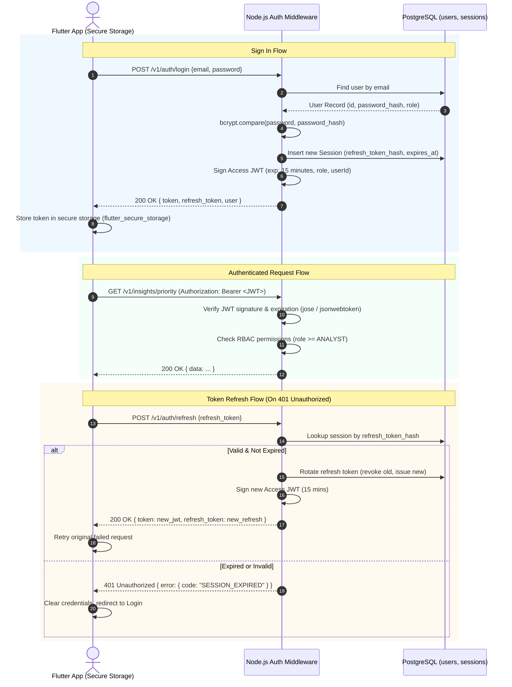

# Decidix — Authentication & Security Architecture

**Document Version:** 2.0.0  
**Status:** Approved Master Architecture  
**Security Standard:** OWASP Top 10 Aligned  
**Auth Strategy:** Backend-Managed JWT with Refresh Token Rotation  

---

## 1. Authentication Strategy & Rationale

Decidix uses **backend-managed JSON Web Tokens (JWT)** with secure password hashing and refresh token rotation.

### Why Backend-Managed JWT?
1. **Zero External Dependency:** Completely eliminates third-party auth vendors (Clerk, Auth0, Appwrite).
2. **Flutter Native Fit:** The existing Flutter client is pre-wired with `AuthInterceptor` in `lib/api/transports/dio_transport.dart`, which automatically injects `Authorization: Bearer <token>` into outgoing requests.
3. **No Lock-In & Zero Cost:** Requires no external SaaS subscription; runs entirely within the Heroku Dyno and PostgreSQL.
4. **Demonstration Reliability:** Never suffers from external API quota drops, credential expiration, or SaaS outages during university graduation defense.

---

## 2. Authentication Flow



---

## 3. Cryptographic & Token Specifications

| Parameter | Standard / Configuration | Implementation Detail |
|---|---|---|
| **Password Hashing** | `bcrypt` (cost factor: 12) or `@node-rs/argon2` | Passwords hashed prior to database persistence; plaintexts never logged or retained in memory. |
| **Access Token (JWT)** | Signed with HMAC-SHA256 (`HS256`) via `jose` or `jsonwebtoken` | Lifetime: **15 minutes**. Payload: `{ sub: userId, role: UserRole, email: string, iat, exp }`. |
| **Refresh Token** | Cryptographically secure random UUIDv4 / 256-bit token | Lifetime: **30 days**. Stored in PostgreSQL as a SHA-256 hash. Revoked on rotation or logout. |
| **Token Transmission** | HTTP Header: `Authorization: Bearer <access_token>` | Transport strictly protected over TLS 1.3 in staging and production. |

---

## 4. Role-Based Access Control (RBAC) Matrix

Decidix defines discrete user roles to mirror administrative and executive hierarchies in regional and national governance:

| Permission / Action | Admin | Decision Maker | Planner | Analyst | Viewer |
|---|:---:|:---:|:---:|:---:|:---:|
| **Public Dashboards & Maps** (`/overview`, `/regions/*`) | ✅ | ✅ | ✅ | ✅ | ✅ |
| **Sector Analytics & KPIs** (`/insights/*`) | ✅ | ✅ | ✅ | ✅ | ✅ |
| **Regional Comparisons & History** | ✅ | ✅ | ✅ | ✅ | ✅ |
| **AI Assistant Inquiries** (`/intelligence/assistant/*`) | ✅ | ✅ | ✅ | ✅ | ❌ |
| **Run What-If Simulations** (`/decisions/simulate`) | ✅ | ✅ | ✅ | ✅ | ❌ |
| **Citizen Reports — Read** | ✅ | ✅ | ✅ | ✅ | ✅ |
| **Citizen Reports — Like (Authenticated)** | ✅ | ✅ | ✅ | ✅ | ✅ |
| **Citizen Reports — Status Management** | ✅ | ✅ | ❌ | ❌ | ❌ |
| **Development Projects — Read** | ✅ | ✅ | ✅ | ✅ | ✅ |
| **Development Projects — Create/Manage** | ✅ | ✅ | ✅ | ❌ | ❌ |
| **Data Indicators — Ingest/Modify** | ✅ | ❌ | ❌ | ❌ | ❌ |
| **User & Device Token Administration** (`/admin/*`) | ✅ | ❌ | ❌ | ❌ | ❌ |

---

## 4.1 Database Session Management & Refresh Token Rotation

A dedicated `Session` model is persisted in PostgreSQL to manage stateful token refresh and instant session revocation:

- **Storage:** Refresh tokens are never stored in plaintext. Tokens are generated using 40 cryptographically random bytes and stored as SHA-256 hashes (`refresh_token_hash`).
- **Rotation:** Upon calling `POST /v1/auth/refresh`, the presented token is immediately revoked (`revoked_at = NOW()`), and a fresh access token (15-minute lifetime) and new refresh token (30-day lifetime) are issued.
- **Reuse Detection:** If an incoming refresh request provides a token that was previously revoked (e.g. from an intercept or replay attempt), the system flags a security breach, revokes **all** active sessions belonging to that user ID, and returns HTTP 401 with error code `TOKEN_REUSE_DETECTED`.
- **Session Revocation:** Calling `POST /v1/auth/logout` marks the session `revoked_at = NOW()`. Administrators can revoke any user's active sessions globally via `POST /v1/admin/users/:id/revoke-sessions`.

---

## 5. Defense-in-Depth Security Controls

### 5.1 HTTP Header Hardening (`helmet`)
Standard Helmet headers are enforced across all endpoints:
- `Strict-Transport-Security`: `max-age=31536000; includeSubDomains; preload`
- `X-Content-Type-Options`: `nosniff`
- `X-Frame-Options`: `DENY`
- `X-XSS-Protection`: `0` (deprecated browser filter disabled in favor of CSP)
- `Content-Security-Policy`: Default restricts unexpected script/style execution.

### 5.2 Rate Limiting & Abuse Prevention (`express-rate-limit`)
- **Global API Rate Limit:** 120 requests / minute per IP address.
- **Authentication Route Rate Limit:** 10 attempts / minute per IP on `/v1/auth/login` and `/v1/auth/register` to block credential stuffing.
- **AI Assistant Rate Limit:** 20 queries / minute per user to control token consumption on OpenRouter.

### 5.3 Cross-Origin Resource Sharing (`cors`)
- Production backend restricts allowed origins to explicit domains or permits native mobile client user-agents (`Dio`).
- Methods restricted to `GET, POST, PUT, DELETE, OPTIONS`.
- Allowed headers: `Content-Type, Authorization, Accept, X-Requested-With`.

### 5.4 Injection Defense & Data Sanitization
- **SQL Injection:** 100% neutralized by parameterized Prisma queries. Raw queries are banned except for typed `pgvector` distance searches.
- **Parameter Pollution:** Express disables array query parsing where scalar values are expected.
- **Validation:** Every payload is verified by Zod before processing. Unexpected fields are stripped.

### 5.5 Secrets Hygiene & Zero-Leakage Policy
- **No Secrets in Source:** API keys, database URLs, and JWT secrets are injected strictly via Heroku config vars.
- **Production Error Masking:** When `NODE_ENV === 'production'`, internal error messages and stack traces are suppressed and replaced with generic error codes:
  ```json
  {
    "error": {
      "code": "INTERNAL_SERVER_ERROR",
      "message": "An unexpected error occurred. Please contact system support."
    }
  }
  ```
- Full diagnostic details are recorded in stdout logs for review via `heroku logs --tail`.

