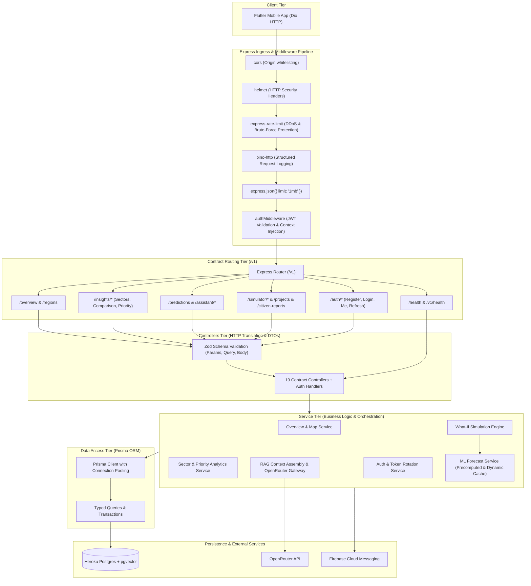

# Decidix — Backend Service Architecture

**Document Version:** 2.0.0  
**Status:** Approved Master Architecture  
**Target Environment:** Node.js 20+ / TypeScript 5.x / Heroku Dyno  

---

## 1. Overview & Architectural Goals

The Decidix backend service is an independent, production-grade REST API located in `backend/`. It acts as the central business logic, data orchestrator, and security gateway between the Flutter mobile application, Heroku Postgres, Python ML components, and OpenRouter AI.

### Core Architecture Objectives:
1. **Strict Contract Adherence:** Implements 100% of the endpoint contracts, parameter conventions, JSON envelopes, and error formats documented in [`docs/api_contract.md`](file:///e:/decidix_app/docs/api_contract.md).
2. **Layered Separation of Concerns:** Rigid isolation between Routing/HTTP (Controllers), Business Logic (Services), and Database Persistence (Prisma ORM Repositories).
3. **Robust Input Validation:** Every incoming HTTP request is validated against strict Zod schemas before reaching the business layer.
4. **Resilient Production Operations:** Structured JSON logging to stdout via Pino, zero runtime unhandled rejections, automatic database connection pooling, and graceful shutdown handling.

---

## 2. Layered Architecture Diagram



---

## 3. Directory Structure

The backend source tree is organized into cohesive modules:

```text
backend/
├── src/
│   ├── config/             # Environment parsing, secrets validation, constants
│   │   ├── env.ts          # Zod-validated process.env schema
│   │   └── logger.ts       # Pino logger instance configured for stdout
│   ├── database/           # Prisma client instance and database utilities
│   │   ├── prisma.ts       # Singleton PrismaClient with retry logic
│   │   └── seed.ts         # Initial regional and indicator seed script
│   ├── middleware/         # Express middleware
│   │   ├── auth.ts         # JWT bearer verification and role-based guards
│   │   ├── error.ts        # Centralized error handler converting to standard format
│   │   ├── rateLimit.ts    # Rate limiters (general: 120/min, auth: 10/min)
│   │   └── validate.ts     # Zod schema validation middleware
│   ├── modules/            # Business feature domains (Vertical Slices)
│   │   ├── auth/           # Login, registration, token refresh, user profile
│   │   ├── overview/       # Dashboard summary, map points, region directories
│   │   ├── insights/       # Education, healthcare, economy, infrastructure analytics
│   │   ├── intelligence/   # ML forecasts, AI assistant chat, AI recommendations
│   │   └── decisions/      # What-if simulations, development projects, citizen reports
│   ├── types/              # TypeScript definitions and shared contract models
│   ├── app.ts              # Express application assembly and middleware binding
│   └── server.ts           # HTTP server startup, port listening, shutdown signals
├── prisma/
│   ├── schema.prisma       # Prisma relational and pgvector schema
│   └── migrations/         # Reversible SQL migrations generated by Prisma
├── test/                   # Vitest unit and Supertest integration test suites
│   ├── contract.test.ts    # Contract envelope and status verification
│   └── integration.test.ts # End-to-end endpoint tests
├── package.json            # Node.js dependencies and build scripts
├── tsconfig.json           # TypeScript strict compiler configuration
└── Procfile                # Heroku deployment process types
```

---

## 4. Middleware Pipeline Specification

Requests flow through the middleware chain in strict sequential order:

1. **`helmet()`**: Sets secure HTTP response headers (`X-Content-Type-Options: nosniff`, `X-Frame-Options: DENY`, `Strict-Transport-Security`, `Content-Security-Policy`).
2. **`cors()`**: Restricts cross-origin resource sharing. In production, allows verified origins or mobile clients (`*` allowed for mobile API with bearer tokens).
3. **`express-rate-limit`**:
   - Standard API endpoints: Max 120 requests per minute per IP.
   - Authentication endpoints (`/v1/auth/*`): Max 10 requests per minute per IP to prevent brute-force attacks.
4. **`pino-http`**: Emits high-performance, structured JSON log lines for every incoming request and response, including `method`, `url`, `statusCode`, `responseTimeMs`, and `reqId`.
5. **`express.json({ limit: '1mb' })`**: Parses JSON request bodies with a strict payload limit.
6. **`authMiddleware`**:
   - Inspects `Authorization: Bearer <token>`.
   - Decodes and validates JWT signature and expiration.
   - Attaches user context `{ userId, role, email }` to `req.user`.
   - On public endpoints (e.g. `/health`, `/v1/overview`), permits unauthenticated access if no token is provided.
7. **`validate(schema)`**: Validates `req.query`, `req.params`, or `req.body` using Zod. Fails early with HTTP 422 if constraints are violated.
8. **Centralized Error Handler (`errorHandler`)**:
   - Catches all synchronous and asynchronous errors forwarded via `next(err)`.
   - Formats errors strictly into the API contract envelope:
     ```json
     {
       "error": {
         "code": "VALIDATION_FAILED",
         "message": "Invalid query parameters provided.",
         "fields": {
           "range": "Expected '3Y', '5Y', or '7Y'"
         }
       }
     }
     ```

---

## 5. API Contract Compliance & Envelope Rules

Every response produced by the backend strictly obeys the guidelines defined in `docs/api_contract.md`:

### 5.1 Success Envelope
- Standard responses return HTTP 200 with `{ "data": <Payload> }`.
- Paginated responses return HTTP 200 with:
  ```json
  {
    "data": [ ... ],
    "meta": {
      "page": 1,
      "per_page": 20,
      "total": 12
    }
  }
  ```

### 5.2 Bilingual Text Guarantee
- Stored content fields are always returned as paired keys: `name` and `arabic_name`, `label` and `arabic_label`, `text` and `arabic_text`.
- The Flutter client dynamically switches language locally using these keys without refetching.

### 5.3 Numeric Conventions
- Raw numbers only, no pre-formatted strings (`18000000`, never `"$18M"`).
- Percentages, progress, and confidence values are formatted as `0` to `100` (`94.2`, never `0.942`).
- Monetary values use composite objects: `{ "amount": 18000000, "currency": "USD" }`.

---

## 6. Health Checks & Operational Endpoints

| Endpoint | Method | Purpose | Response |
|---|---|---|---|
| `/health` | GET | Heroku Dyno health probe and load balancer verification | `200 OK` `{ "status": "ok", "uptime": 1243.5, "timestamp": "2026-11-02T19:00:00Z" }` |
| `/v1/health` | GET | Detailed subsystem health (DB ping, ML status) | `200 OK` `{ "status": "ok", "database": "connected", "ml_engine": "ready", "version": "1.0.0" }` |

---

## 7. Process Lifecycle & Heroku Dyno Management

- **Procfile:**
  ```text
  web: node dist/server.js
  release: npx prisma migrate deploy
  ```
- **Port Binding:** The server listens on `process.env.PORT` provided dynamically by the Heroku dyno environment, defaulting to `3000` in local development.
- **Graceful Shutdown:** Listens for `SIGTERM` and `SIGINT`. Upon signal:
  1. Stops accepting new incoming connections.
  2. Completes active in-flight requests (up to 10 seconds timeout).
  3. Disconnects Prisma client connection pool cleanly.
  4. Exits process with code `0`.

---

## 8. What-If Scenario Simulation Engine (`SimulatorService`)

The simulation engine ([`SimulatorService`](file:///e:/decidix_app/backend/src/services/simulator.service.ts)) models how prospective capital allocations affect composite regional development performance.

### 8.1 Mathematical Specification
- **Concave Diminishing Returns Function:**
  $$Gain(d, A, r) = \beta(r) \cdot \alpha(d) \cdot K(d) \cdot \ln\left(1 + \frac{A}{K(d)}\right)$$
  Where:
  - $A \ge 0$: Allocated budget in USD per sector.
  - $K(d) = \$60,000,000$: Saturation capital constant.
  - $\beta(r) = 1.0 + 0.5 \cdot \left(\frac{100 - Score_r}{100}\right)$: Regional development deficit multiplier ($1.0 \le \beta(r) \le 1.5$).
  - $\alpha(d)$: Base responsiveness slope per USD:
    - Healthcare: $0.07235 \times 10^{-6}$ points/USD ($0.07235$ / \$1M)
    - Infrastructure: $0.05250 \times 10^{-6}$ points/USD ($0.05250$ / \$1M)
    - Education: $0.04820 \times 10^{-6}$ points/USD ($0.04820$ / \$1M)
    - Economy: $0.04600 \times 10^{-6}$ points/USD ($0.04600$ / \$1M)

### 8.2 Analytical Marginal Yield & Dynamic Best Lever
- **Effective Marginal Yield per \$1,000,000:**
  $$\frac{\partial Gain}{\partial A} \times 1,000,000 = \frac{\beta(r) \cdot \alpha(d) \cdot 1,000,000}{1 + \frac{A}{K(d)}}$$
- **Dynamic Ranking:** As capital is allocated to a sector, its marginal yield strictly decreases. `best_lever` dynamically selects the sector with the highest current marginal yield, rather than relying on a static base coefficient.
- **Deterministic Tie-Breaking:** When two sectors yield identical rounded marginal yields, ties are resolved deterministically using fixed domain priority (`healthcare` > `infrastructure` > `education` > `economy`).

### 8.3 Score Ceiling Invariants & Proportional Rescaling
- **Invariant Rules:**
  1. $projected\_score = \min(100.0, today\_score + gain) \le 100.0$.
  2. $today\_score + gain = projected\_score$ identically.
  3. $\sum_{d} lever\_gain(d) = gain$ within floating point tolerance ($\pm 0.05$).
- **Ceiling Clamping & Scaling:**
  When $today\_score + raw\_gain_{total} \ge 100.0$, the effective total gain is clamped to $100.0 - today\_score$, and each sector's lever gain is scaled down proportionally by $scale = \frac{effective\_gain}{raw\_gain_{total}}$. This preserves internal consistency in the Flutter UI without contradiction.
- **Metadata Transparency:**
  `metadata.ceiling_hit: boolean` and `metadata.unconstrained_gain: number` are included in the response payload for full model transparency.

### 8.4 Sensitivity Analysis & Robustness Verification (Phase C4.3)
- **Dimensional Verification:**
  - $A$ and $K(d)$ are measured in USD (\$); the ratio $A/K(d)$ is dimensionless.
  - $\beta(r) \in [1.0, 1.5]$ is a dimensionless regional scaling multiplier.
  - $\alpha(d)$ has dimensions $[points / \$]$; $\alpha(d) \cdot K(d)$ has dimensions $[points]$.
  - Marginal yield has dimensions $[points / \$1,000,000]$.
- **Sensitivity Properties:**
  - **Alpha Sensitivity:** Gains and yields scale linearly with $\alpha(d)$ ($Gain(\lambda \alpha) = \lambda \cdot Gain(\alpha)$).
  - **Saturation Constant $K$ Sensitivity:** For infinitesimal budgets ($A \to 0$), gain converges identically regardless of $K$ ($\lim_{A \to 0} K \ln(1 + A/K) = A$). For large allocations ($A \ge \$50\text{M}$), larger $K$ delays saturation, producing monotonically higher gains.
  - **Regional Baseline Sensitivity:** $\beta(r)$ decreases linearly from $1.50$ (score 0) to $1.00$ (score 100). Lower-scoring regions receive up to 50% greater marginal returns than regions at the ceiling.
  - **Defensive Validation:** Allocations strictly reject non-finite values (`NaN`, `Infinity`, `-Infinity`), negative numbers, and missing objects with HTTP 400. Baseline scores outside $[0, 100]$ are clamped safely.

### 8.5 Academic Status & Empirical Disclaimer
- **Simulation Type:** `illustrative` (academic policy scenario model).
- **Disclaimer:** Parameters are illustrative heuristic configurations calibrated to regional development index scales. No empirical macroeconomic or econometric elasticity panel data exists in the repository. The simulator must not be presented as an empirically verified macroeconomic forecast.


