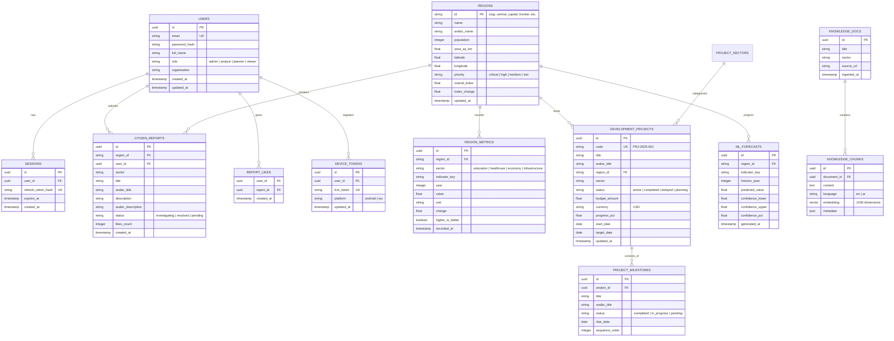

# Decidix — Database & Data Persistence Architecture

**Document Version:** 2.1.0  
**Status:** Approved Master Architecture (Live Deployment Pending Phase D)  
**Target Platform:** Heroku Postgres (`essential-0` Plan, PostgreSQL 15+ — Pending Provisioning)  
**ORM / Data Layer:** Prisma ORM 5.x  
**Vector Engine:** PostgreSQL `pgvector` (`vector(1536)`) with Zero-Cost Local Embeddings  

---

## 1. Overview & Core Principles

PostgreSQL is the **single authoritative source of truth** for all Decidix application state. It manages all transactional data, analytical indicators, regional time-series, development projects, citizen feedback, device registration tokens, and RAG knowledge vectors.

### Operational State & Phase B4 Clarification:
- **Code-Level Verification Completed (Phase B4):** All 13 Prisma models, SQL baseline migrations (`0_init`), typed repositories, Decimal-to-number serializers, and JWT session rotation have been code-audited and verified with in-memory fallbacks (70/70 backend tests passing).
- **Live Infrastructure Pending (Phase D):** Heroku app provisioning and live PostgreSQL instance attachment remain **pending Phase D staging deployment**. No live database has been provisioned yet.
- **Zero-Cost Vector Strategy:** RAG embeddings use the local deterministic 1536-dimensional L2-normalized projection engine (`deterministic-fnv1a-v1`). The previously proposed OpenAI embedding model (`openai/text-embedding-3-small`) is explicitly rejected as an unapproved paid dependency. Strictly no paid services or paid embedding APIs are permitted without owner approval.

### Core Database Directives:
1. **Single Source of Truth:** No competing master data stores. Appwrite and external databases are completely eliminated.
2. **Relational Integrity:** Strict foreign keys, unique constraints, and check constraints to prevent corrupt or orphan records.
3. **Native Vector Search:** Uses the native PostgreSQL `pgvector` extension for knowledge embeddings, avoiding expensive external vector databases.
4. **Connection Pool Discipline:** Heroku Postgres `essential-0` provides 20 max connections. Prisma connection pool size is capped at 10-12 connections per dyno to prevent connection exhaustion.
5. **Reversible Migrations:** All schema changes are tracked in versioned SQL migration files managed by Prisma CLI.

---

## 2. Entity-Relationship Data Model



---

## 3. Prisma Schema Design (`backend/prisma/schema.prisma`)

```prisma
datasource db {
  provider   = "postgresql"
  url        = env("DATABASE_URL")
  extensions = [pgvector(map: "vector")]
}

generator client {
  provider        = "prisma-client-js"
  previewFeatures = ["postgresqlExtensions"]
}

enum UserRole {
  ADMIN
  ANALYST
  PLANNER
  VIEWER
}

enum PriorityLevel {
  CRITICAL
  HIGH
  MEDIUM
  LOW
}

enum SectorType {
  OVERALL
  EDUCATION
  HEALTHCARE
  ECONOMY
  INFRASTRUCTURE
}

enum ProjectStatus {
  PLANNING
  ACTIVE
  DELAYED
  COMPLETED
}

enum ReportStatus {
  PENDING
  INVESTIGATING
  RESOLVED
}

model User {
  id            String         @id @default(uuid()) @db.Uuid
  email         String         @unique
  passwordHash  String         @map("password_hash")
  fullName      String         @map("full_name")
  role          UserRole       @default(ANALYST)
  organization  String?
  sessions      Session[]
  deviceTokens  DeviceToken[]
  citizenReports CitizenReport[]
  reportLikes   ReportLike[]
  createdAt     DateTime       @default(now()) @map("created_at")
  updatedAt     DateTime       @updatedAt @map("updated_at")

  @@map("users")
}

model Session {
  id               String   @id @default(uuid()) @db.Uuid
  userId           String   @map("user_id") @db.Uuid
  user             User     @relation(fields: [userId], references: [id], onDelete: Cascade)
  refreshTokenHash String   @unique @map("refresh_token_hash")
  expiresAt        DateTime @map("expires_at")
  createdAt        DateTime @default(now()) @map("created_at")

  @@map("sessions")
}

model DeviceToken {
  id        String   @id @default(uuid()) @db.Uuid
  userId    String   @map("user_id") @db.Uuid
  user      User     @relation(fields: [userId], references: [id], onDelete: Cascade)
  fcmToken  String   @unique @map("fcm_token")
  platform  String   @default("android")
  updatedAt DateTime @updatedAt @map("updated_at")

  @@map("device_tokens")
}

model Region {
  id           String               @id // slug e.g. "central_capital"
  name         String
  arabicName   String               @map("arabic_name")
  population   Int
  areaSqKm     Float                @map("area_sq_km")
  latitude     Float
  longitude    Float
  priority     PriorityLevel        @default(MEDIUM)
  overallIndex Float                @map("overall_index")
  indexChange  Float                @map("index_change")
  metrics      RegionMetric[]
  projects     DevelopmentProject[]
  reports      CitizenReport[]
  forecasts    MlForecast[]
  updatedAt    DateTime             @updatedAt @map("updated_at")

  @@index([priority])
  @@map("regions")
}

model RegionMetric {
  id             String     @id @default(uuid()) @db.Uuid
  regionId       String     @map("region_id")
  region         Region     @relation(fields: [regionId], references: [id], onDelete: Cascade)
  sector         SectorType
  indicatorKey   String     @map("indicator_key")
  year           Int
  value          Float
  unit           String
  change         Float
  higherIsBetter Boolean    @default(true) @map("higher_is_better")
  recordedAt     DateTime   @default(now()) @map("recorded_at")

  @@unique([regionId, indicatorKey, year])
  @@index([sector, indicatorKey])
  @@map("region_metrics")
}

model DevelopmentProject {
  id           String             @id @default(uuid()) @db.Uuid
  code         String             @unique // PRJ-2025-001
  title        String
  arabicTitle  String             @map("arabic_title")
  regionId     String             @map("region_id")
  region       Region             @relation(fields: [regionId], references: [id], onDelete: Cascade)
  sector       SectorType
  status       ProjectStatus      @default(ACTIVE)
  budgetAmount Float              @map("budget_amount")
  currency     String             @default("USD")
  progressPct  Float              @map("progress_pct")
  startDate    DateTime           @map("start_date") @db.Date
  targetDate   DateTime           @map("target_date") @db.Date
  milestones   ProjectMilestone[]
  updatedAt    DateTime           @updatedAt @map("updated_at")

  @@index([status, sector])
  @@map("development_projects")
}

model ProjectMilestone {
  id            String             @id @default(uuid()) @db.Uuid
  projectId     String             @map("project_id") @db.Uuid
  project       DevelopmentProject @relation(fields: [projectId], references: [id], onDelete: Cascade)
  title         String
  arabicTitle   String             @map("arabic_title")
  status        String             // completed | in_progress | pending
  dueDate       DateTime           @map("due_date") @db.Date
  sequenceOrder Int                @default(1) @map("sequence_order")

  @@map("project_milestones")
}

model CitizenReport {
  id                String       @id @default(uuid()) @db.Uuid
  regionId          String       @map("region_id")
  region            Region       @relation(fields: [regionId], references: [id], onDelete: Cascade)
  userId            String       @map("user_id") @db.Uuid
  user              User         @relation(fields: [userId], references: [id], onDelete: Cascade)
  sector            SectorType
  title             String
  arabicTitle       String       @map("arabic_title")
  description       String
  arabicDescription String       @map("arabic_description")
  status            ReportStatus @default(PENDING)
  likesCount        Int          @default(0) @map("likes_count")
  likes             ReportLike[]
  createdAt         DateTime     @default(now()) @map("created_at")

  @@index([regionId, status])
  @@map("citizen_reports")
}

model ReportLike {
  userId    String        @map("user_id") @db.Uuid
  reportId  String        @map("report_id") @db.Uuid
  user      User          @relation(fields: [userId], references: [id], onDelete: Cascade)
  report    CitizenReport @relation(fields: [reportId], references: [id], onDelete: Cascade)
  createdAt DateTime      @default(now()) @map("created_at")

  @@id([userId, reportId])
  @@map("report_likes")
}

model MlForecast {
  id               String    @id @db.VarChar(64)
  regionId         String?   @map("region_id") @db.VarChar(64)
  indicatorId      String    @default("development_index") @map("indicator_id") @db.VarChar(64)
  forecastYear     Int       @map("forecast_year")
  predictedValue   Decimal   @map("predicted_value") @db.Decimal(5, 1)
  lowerBound       Decimal?  @map("lower_bound") @db.Decimal(5, 1)
  upperBound       Decimal?  @map("upper_bound") @db.Decimal(5, 1)
  confidenceLevel  Decimal?  @default(0.95) @map("confidence_level") @db.Decimal(3, 2)
  modelName        String    @default("temporal_ensemble") @map("model_name") @db.VarChar(64)
  modelVersion     String    @default("1.0.0") @map("model_version") @db.VarChar(32)
  forecastSource   String    @default("official_planning") @map("forecast_source") @db.VarChar(64)
  forecastMethod   String    @default("temporal_ensemble") @map("forecast_method") @db.VarChar(64)
  validationStatus String    @default("validated") @map("validation_status") @db.VarChar(32)
  isCalibrated     Boolean   @default(true) @map("is_calibrated")
  createdAt        DateTime  @default(now()) @map("created_at") @db.Timestamptz

  region           Region?   @relation(fields: [regionId], references: [id], onDelete: Cascade)

  @@unique([regionId, indicatorId, forecastYear, modelVersion, validationStatus], map: "uq_ml_forecasts")
  @@index([forecastYear], map: "idx_ml_forecasts_year")
  @@index([regionId], map: "idx_ml_forecasts_region")
  @@index([validationStatus], map: "idx_ml_forecasts_status")
  @@index([indicatorId], map: "idx_ml_forecasts_indicator")
  @@map("ml_forecasts")
}

model KnowledgeDocument {
  id         String           @id @default(uuid()) @db.Uuid
  title      String
  sector     SectorType
  sourceUrl  String?          @map("source_url")
  chunks     KnowledgeChunk[]
  ingestedAt DateTime         @default(now()) @map("ingested_at")

  @@map("knowledge_documents")
}

model KnowledgeChunk {
  id         String                       @id @default(uuid()) @db.Uuid
  documentId String                       @map("document_id") @db.Uuid
  document   KnowledgeDocument            @relation(fields: [documentId], references: [id], onDelete: Cascade)
  content    String
  language   String                       @default("en") // en | ar
  embedding  Unsupported("vector(1536)")?
  metadata   Json                         @default("{}")

  @@map("knowledge_chunks")
}
```

---

## 4. Native Vector Search (`pgvector`) Specification

Heroku Postgres 15+ supports `pgvector` natively. When initializing the database in Phase D, the extension is activated:

```sql
CREATE EXTENSION IF NOT EXISTS vector;
```

### Zero-Cost Embedding Provenance
All knowledge vectors are 1536-dimensional float arrays generated via the local deterministic L2-normalized engine (`deterministic-fnv1a-v1`). Paid embedding APIs (such as OpenAI `text-embedding-3-small`) are strictly rejected under the university project Zero-Cost Policy.

### Vector Search Query Pattern
For RAG retrieval, cosine similarity (`<=>`) queries find the most relevant document chunks for user inquiries:

```sql
SELECT 
    id, 
    content, 
    language, 
    metadata, 
    1 - (embedding <=> $1::vector) AS similarity
FROM knowledge_chunks
WHERE 1 - (embedding <=> $1::vector) > 0.65
ORDER BY similarity DESC
LIMIT 4;
```

---

## 5. Performance, Indexing & Connection Limits

1. **Connection Pooling:**
   - Heroku Postgres `essential-0` allows a maximum of 20 concurrent connections.
   - Prisma Client connection limit is configured via the database URL:
     `DATABASE_URL="postgres://...?sslmode=require&connection_limit=10"`
   - This reserves headroom for database migrations and CLI maintenance sessions.

2. **Indexing Strategy:**
   - Foreign keys are indexed to prevent sequential scans during relation joins.
   - Compound indexes cover frequent query patterns:
     - `region_metrics(sector, indicator_key)`
     - `development_projects(status, sector)`
     - `citizen_reports(region_id, status)`
     - `ml_forecasts(region_id, indicator_key, horizon_year)`
   - HNSW index on `knowledge_chunks.embedding` for fast vector retrieval.

