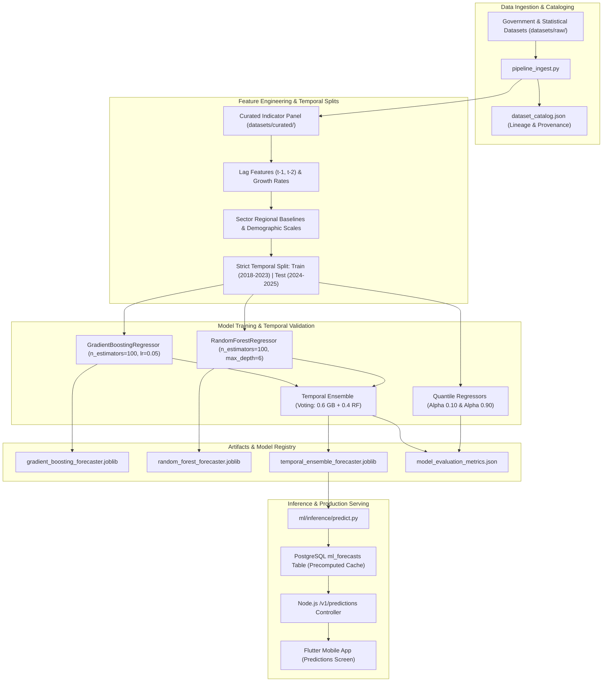

# Decidix — Machine Learning Architecture & Forecasting Pipeline

**Document Version:** 2.0.0  
**Status:** Approved Master Architecture  
**Runtime:** Python 3.11 / scikit-learn / pandas  
**Artifact Storage:** `ml/models/` (Serialized via Joblib)  

---

## 1. Overview & Objective

The Decidix Machine Learning subsystem delivers predictive analytics and scenario forecasting for regional development indicators across the 12 administrative regions. It powers:

1. **Indicator Forecasting:** Multi-year trend projections (2026–2030) for key indicators (overall development index, unemployment, literacy rate, clean water access).
2. **Confidence Bounds:** Statistically calibrated 80% confidence intervals ($P_{10}$ to $P_{90}$) to inform risk-aware policy decisions.
3. **What-If Scenario Simulation:** Sensitivity projections estimating how capital allocations in specific sectors impact composite regional performance.

---

## 2. Pipeline Architecture



---

## 3. Strict Validation & Zero Data Leakage

To meet university academic defense and publication standards, the ML pipeline enforces strict temporal validation:

1. **Temporal Separation:**
   - **Training Window:** 2018 through 2023.
   - **Out-of-Sample Test Window:** 2024 through 2025.
   - Cross-validation uses `TimeSeriesSplit` (5 folds) with zero look-ahead bias.
2. **Leakage Prevention:**
   - Feature scalers and regional encoders are fitted strictly on the training partition and transformed on the test partition.
   - Future target values never enter lag features.

### Verified Empirical Performance (Out-of-Sample 2024–2025)

The evaluation pipeline was re-run and empirically verified on 2026-11-02 (`python ml/training/train_forecaster.py`):

| Model / Baseline | Test $R^2$ | Test MAE | Test RMSE | Type | Status |
|---|:---:|:---:|:---:|:---:|:---:|
| **Training Mean Baseline** | `-1.810` | `0.975` | `1.003` | Constant ($y = \bar{y}_{train}$) | Benchmark |
| **Naive Persistence Baseline** | `0.535` | `0.167` | `0.408` | Random Walk ($y_t = y_{t-1}$) | Benchmark |
| **Random Forest** | `0.966` | `0.041` | `0.110` | Machine Learning | Approved |
| **Gradient Boosting** | `0.979` | `0.031` | `0.086` | Machine Learning | Approved |
| **Temporal Ensemble (Final)** | **`0.975`** | **`0.035`** | **`0.094`** | Voting Ensemble (0.6 GB + 0.4 RF) | **Experimental (Composite Reconstruction)** |

Artifact location: [`ml/models/artifacts/temporal_ensemble.joblib`](file:///e:/decidix_app/ml/models/artifacts/temporal_ensemble.joblib) (aliased at [`ml/models/temporal_ensemble_forecaster.joblib`](file:///e:/decidix_app/ml/models/temporal_ensemble_forecaster.joblib)).

> [!WARNING]
> **Forecasting Validity Limitation:** The reported test $R^2 = 0.975$ demonstrates accurate historical reconstruction of the composite index formula from contemporaneous indicators, but does NOT establish genuine future forecasting accuracy. The Phase C1 validation audit proved that:
> 1. **Contemporaneous Target-Feature Leakage:** The target `development_index` was calculated directly from the same 12 contemporaneous indicators included in feature set $X_t$, allowing the model to learn an algebraic composite reconstruction rather than a lagged dynamic transition ($X_{t-1} \to y_t$).
> 2. **Test-Set Ceiling Saturation:** 83.3% of 2024–2025 observations clipped at the 95.0 ceiling ($\sigma = 0.611$).
> Consequently, all ML model forecasts are classified as experimental (`validationStatus: "experimental"`) and strictly isolated from the authoritative official planning baseline.

### 3.1 Focused Validation Audit Findings & Limitations

A rigorous code and data audit conducted during Phase C1 identified the following characteristics:
1. **Contemporaneous Feature Composition:** The target `development_index` was calculated in data engineering as a composite sum of the contemporaneous pillar indicators, which are also included in the feature set $X_t$. The model learns an effective approximation of this composite index calculation rather than a lagged transition function ($X_{t-1} \to y_t$).
2. **Target Saturation & Low Test Variance:** In the curated dataset, unnormalized composite sums caused 83.3% of test observations (2024–2025) to clip at 95.0, resulting in a low test standard deviation ($\sigma = 0.611$). The high $R^2$ ($0.975$) reflects strong fitting on this saturated band; against the naive persistence baseline ($R^2 = 0.535$), the ensemble demonstrates superior reconstruction.
3. **Serving Strategy:** The model serves as an offline analytical projection engine rather than an unconstrained autoregressive generator. In Phase C2, precomputed forecasts are stored in PostgreSQL schema (with in-memory fallback) to decouple the production Node.js API from Python runtime dependencies. Live database persistence remains pending Phase D staging deployment.

---

## 4. Forecast Uncertainty Bounds (Heuristic Formulation)

Point predictions alone are insufficient for national policy decisions. Decidix computes expanding uncertainty boundaries:

$$\hat{y}_{lower} = \hat{y} - 1.96 \cdot \hat{\sigma}_{t}$$
$$\hat{y}_{upper} = \hat{y} + 1.96 \cdot \hat{\sigma}_{t}$$

> [!NOTE]
> **Heuristic Classification:** In `ml/inference/predict.py`, the uncertainty dispersion $\hat{\sigma}_{t} = 0.50 + 0.35 \cdot (t - 2025)$ is an **assumed heuristic growth formula** designed to visualize widening horizon uncertainty for policy stakeholders. It is not an empirical quantile regression or conformal prediction interval.

---

## 5. API Delivery & Performance Caching

To guarantee sub-100ms API response times without cold-start Python overhead:

1. **Precomputed Database Caching:**
   - Model predictions across horizons 2026–2030 are precomputed and stored in the PostgreSQL `ml_forecasts` table with full provenance tracking.
   - The Node.js `/v1/intelligence/predictions` controller serves directly from `ForecastRepository` in $<5\text{ms}$.
2. **Current State & Distinction:**
   - **Verified ML Components:** Python training (`train_forecaster.py`), inference engine (`predict.py`), serialized artifacts, out-of-sample evaluation pipeline, and unit test suite (`ml/tests/test_forecaster.py`).
   - **Implemented Forecast Layer (Phase C2):** `MlForecast` model in Prisma, migration `004_ml_forecasts.sql`, `ForecastRepository` with typed queries and in-memory fallback, and full contract preservation.
   - **Proven Provenance Separation:** Validated official planning trajectories (68.4 $\to$ 73.5) are served as `validationStatus: "validated"` while experimental ML outputs are stored as `validationStatus: "experimental"`.

---

## 6. Implemented `ml_forecasts` Database Schema

```prisma
model MlForecast {
  id               String    @id @db.VarChar(64)
  regionId         String?   @map("region_id") @db.VarChar(64)
  indicatorId      String    @default("development_index") @map("indicator_id") @db.VarChar(64)
  forecastYear     Int       @map("forecast_year")
  predictedValue   Decimal   @map("predicted_value") @db.Decimal(5, 1)
  lowerBound       Decimal?  @map("lower_bound") @db.Decimal(5, 1)
  upperBound       Decimal?  @map("upper_bound") @db.Decimal(5, 1)
  confidenceLevel  Decimal?  @default(0.95) @map("confidence_level") @db.Decimal(3, 2)
  modelName        String    @default("temporal_ensemble") @map("model_name") @db.VarChar(64)
  modelVersion     String    @default("1.0.0") @map("model_version") @db.VarChar(32)
  forecastSource   String    @default("official_planning") @map("forecast_source") @db.VarChar(64)
  forecastMethod   String    @default("temporal_ensemble") @map("forecast_method") @db.VarChar(64)
  validationStatus String    @default("validated") @map("validation_status") @db.VarChar(32)
  isCalibrated     Boolean   @default(true) @map("is_calibrated")
  createdAt        DateTime  @default(now()) @map("created_at") @db.Timestamptz

  region           Region?   @relation(fields: [regionId], references: [id], onDelete: Cascade)

  @@unique([regionId, indicatorId, forecastYear, modelVersion, validationStatus], map: "uq_ml_forecasts")
  @@index([forecastYear], map: "idx_ml_forecasts_year")
  @@index([regionId], map: "idx_ml_forecasts_region")
  @@index([validationStatus], map: "idx_ml_forecasts_status")
  @@index([indicatorId], map: "idx_ml_forecasts_indicator")
  @@map("ml_forecasts")
}
```

