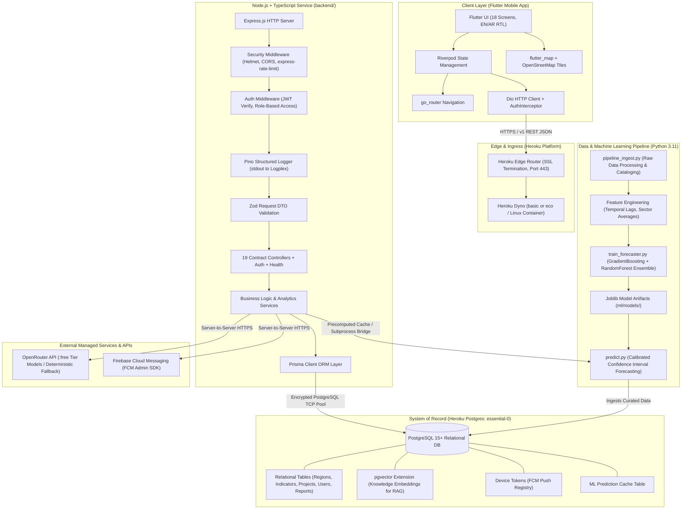
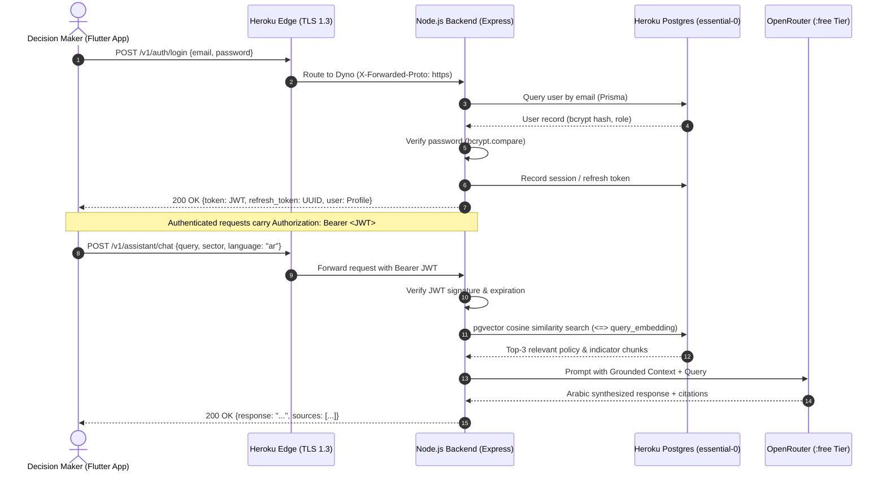

# Decidix — System Architecture Specification

**Document Version:** 2.0.0  
**Status:** Approved Master Architecture  
**Target Horizon:** 2026 – July 2027 (University Graduation Project)  
**Primary Platform:** Heroku Cloud Application Platform  

---

## 1. System Overview & Mission

Decidix is a bilingual (Arabic & English, RTL-native) Smart Development Decision Support System designed for regional development decision-makers, analysts, and national planners. The system ingests, normalizes, and analyzes cross-sectoral development indicators across 12 administrative regions covering four core domains:

1. **Education** (literacy, teacher ratios, graduation rates, STEM readiness)
2. **Healthcare** (hospital beds, physician density, infant mortality, health centers)
3. **Economy & Employment** (unemployment, GDP per capita, SME growth, labor participation)
4. **Infrastructure & Utilities** (clean water access, renewable energy grid, road density, digital broadband)

The platform provides descriptive dashboards, interactive GIS maps, comparative regional analytics, historical trends, priority matrices, machine learning forecasting, what-if scenario simulations, citizen feedback monitoring, and an interactive RAG-grounded AI intelligence assistant.

---

## 2. Master System Architecture Diagram

---

## 3. Component Boundary Definitions

| Architectural Tier | Technology | Responsibility | Isolation Boundary |
|---|---|---|---|
| **Mobile Client** | Flutter 3.x / Dart 3.13+ | Presentation, UI rendering, local navigation, offline asset caching, language switching. | Consumes ONLY `https://<api>/v1` endpoints via strictly typed JSON models. Never connects directly to database or ML scripts. |
| **Edge & Compute** | Heroku Common Runtime (`eu`) | TLS termination, dyno lifecycle, process supervision, routing. | Manages ephemeral Linux containers (`web` dyno). No persistent local disk storage. |
| **API Backend** | Node.js 20+ / TypeScript 5.x / Express | Business rules, authorization, session management, input validation, API contract compliance. | Isolated in `backend/`. Connects to PostgreSQL via pooled TCP connection; invokes external APIs server-to-side. |
| **System of Record** | Heroku Postgres (`essential-0`) | Authoritative transactional data, analytical indicators, RAG knowledge embeddings, user credentials. | Single master database. Accessible only via authenticated backend DATABASE_URL. |
| **Data & ML Engine**| Python 3.11 / scikit-learn / pandas | Dataset ingestion, indicator imputation, temporal training, model evaluation, calibrated inference. | Code lives in `ml/` and `scripts/`. Model artifacts exported to `ml/models/`. Forecasts cached in PostgreSQL for instantaneous API delivery. |
| **AI Intelligence** | OpenRouter API + pgvector RAG | Natural language query comprehension, document synthesis, grounded policy recommendations. | Backend acts as secure intermediary. Client never holds OpenRouter API keys. Strict fallback when retrieval similarity falls below threshold. |
| **Notifications** | Firebase Cloud Messaging (FCM) | Device registration and targeted push broadcasts. | Managed via official `firebase-admin` SDK server-side. Zero client administrative privileges. |

---

## 4. Cross-Cutting Design Principles

### 4.1 "Don't Reinvent the Wheel"
- Every core concern (ORM, authentication, schema validation, HTTP security, structured logging, push messaging, vector search) uses mature, industry-standard, actively maintained packages and official SDKs.
- Zero custom crypto, custom ORM query builders, or custom vector indexing implementations.

### 4.2 Strict Layer Decoupling
- The Flutter client is 100% transport-agnostic: toggling between `MockTransport` and `DioTransport` is a single configuration flag (`USE_MOCK`).
- The Node.js backend implements controllers that adhere strictly to `docs/api_contract.md`. If the backend changes internal schema or joins, the API output shape remains identical.
- Machine Learning training runs asynchronously during model updating phases. The production API serves forecasts from precomputed cached tables or high-speed in-memory model inference, ensuring API response times under 150ms.

### 4.3 Total Appwrite Elimination
- Historical references to Appwrite (Auth, Database, Storage) are permanently superseded.
- Authentication is governed by backend-managed JWTs with bcrypt password hashing stored in PostgreSQL.
- File storage requirements for the graduation demo are minimal: the citizen reports feature displays community reports and like counters. If photo attachments are introduced, they are stored as BYTEA/Base64 thumbnails or hosted via free Cloudflare R2 (10 GB free tier with zero egress costs).

### 4.4 Low-Cost Graduation Project Alignment
- Total recurring infrastructure cost is maintained between **$10.00 and $12.00 / month**, fully covered by the **$13.00 / month GitHub Student Developer Pack credits** on Heroku through approximately June/July 2027.
- Zero paid third-party add-ons from the Heroku marketplace.

---

## 5. Security & Boundary Architecture

---

## 6. System Verification Standards

1. **Flutter Client:** Zero analyzer warnings (`flutter analyze`), 100% unit and widget test pass rate (`flutter test`), 100% API contract compliance (`test/api_contract_test.dart`).
2. **Backend API:** Full TypeScript strict compilation (`npm run build`), 100% test pass rate with Vitest/Supertest (`npm test`), exact JSON envelope matching for all 19 contract endpoints.
3. **Database:** Fully reversible Prisma migrations (`prisma migrate deploy`), automated daily backups (`pg:backups`), verified foreign keys and index constraints.
4. **Machine Learning:** Zero temporal leakage, out-of-sample $R^2 \ge 0.95$, calibrated confidence intervals (10th to 90th percentile).
5. **AI RAG:** 100% grounded answers; refusal to answer with clear explanation when retrieval similarity is below 0.65 threshold.

